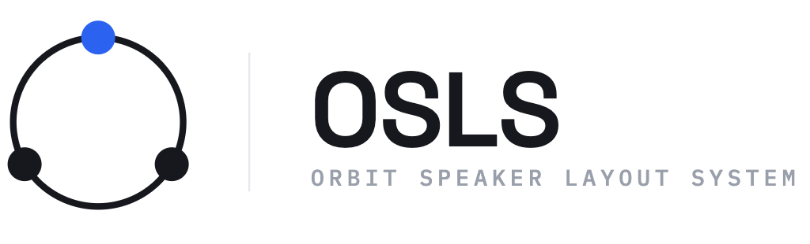

<p align="center">
  <picture>
    <source media="(prefers-color-scheme: dark)" srcset="brand/logo/png/osls-lockup-white.png">
    
  </picture>
</p>

<p align="center"><strong>Speaker layouts, declaratively.</strong></p>

# OSLS — Orbit Speaker Layout System

**An open, format-agnostic way to describe loudspeaker layouts as a single human-readable file.**

A speaker layout — 7.1.4, 9.1.6, 22.2, Auro, or an arbitrary custom rig — is one `.osls` file: where the speakers are, what they're called (a stable ITU-R BS.2051 identity), and their reference frame. The **per-spec channel order** (ADM, IAMF, MPEG-H…) isn't restated in every file — a small SDK resolves it from a shared profiles registry by matching each speaker's identity. OSLS doesn't care whether a format already exists in some standard; if you can describe the rig, it works. Read the file and the layout is fully defined — positions, labels, channel order, LFE — ready to drive panners, meters, routing matrices, and binaural virtual-speaker sets.

> **Status:** v1 spec foundation (format + schema + blessed layouts) with a working **`@orbitspatial/osls-core`** SDK (TypeScript engine + C ABI and Swift/WASM bindings), an MCP server, and a browser 3D **designer** (in its own repo).

## Why

Speaker-layout tables get hardcoded and duplicated across an app, an engine, and a UI — and they drift, disagree on labels/order, and need code changes to add a format. OSLS replaces that with one file per layout and one small SDK, so **adding a format is adding a file** and there's a single source of truth for everyone (native apps, the browser, Windows, mobile).

## A layout in one file

```yaml
osls: 1
id: "7.1.4"
name: "7.1.4"
frame: egocentric               # listener-relative (sphere); allocentric = room-anchored (cube)
speakers:
  - { id: L,   label: L,   sp: M+030, x: -0.5, y: 0.866, z: 0.0 }
  - { id: C,   label: C,   sp: M+000, x:  0.0, y: 1.0,   z: 0.0 }
  - { id: LFE, label: LFE, sp: LFE1,  x:  0.0, y: 1.0,   z: -0.5, lfe: true }
  - { id: Lss, label: Lss, sp: M+090, x: -1.0, y: 0.0,   z: 0.0, aliases: [Ls] }
  # … the rest of the rig …
```

One rig, described once. Each speaker carries a stable **ITU-R BS.2051 SP-label** (`M+030`, `LFE1`, …) and its position — Cartesian `x/y/z`, polar `az/el`, or both. The **per-spec channel orders** (ADM vs IAMF — e.g. IAMF moves C to index 1 and LFE last) aren't stored in the file: for blessed layouts they live in the [`profiles/`](profiles) registry, keyed by SP-label and projected onto the rig by `@orbitspatial/osls-core` (`layout.ordering("iamf")`). See [`layouts/`](layouts) for the blessed set and [`docs/SPEC.md`](docs/SPEC.md) for the full format.

## What OSLS is (and isn't)

OSLS describes the **rig** — geometry (in an **allocentric**/room or **egocentric**/listener frame), identity (ITU-R BS.2051 SP-labels + labels + aliases), per-spec channel ordering, LFE. It is deliberately **not** a renderer (down-mix/panning/HRTF math stays in the engine) and **not** a patch map (which physical output a channel hits is the app's job). Keeping it that small is the point.

## Using it

- **TypeScript** — [`@orbitspatial/osls-core`](sdk/ts) parses, validates, serialises, and projects orderings: `parseLayout(text)`, `layout.ordering("iamf")`, `layout.frame`. The 14 blessed layouts ship as `PRESETS`.
- **C / Swift / WASM** — the same engine via a C ABI ([`sdk/core`](sdk/core)), a Swift binding ([`sdk/swift`](sdk/swift)), and an Emscripten/WASM build ([`sdk/wasm`](sdk/wasm)) — so the browser resolves layouts identically to a native app.
- **MCP** — an [MCP server](sdk/mcp) exposes the engine to AI agents and editors as tools (parse, validate, list/load presets).

## Repository

| Path | What |
|---|---|
| [`docs/SPEC.md`](docs/SPEC.md) | The `.osls` format specification. |
| [`schema/osls.schema.json`](schema/osls.schema.json) | JSON Schema — the contract every consumer validates against. |
| [`layouts/`](layouts) | Blessed, spec-verified core layouts — see the [catalogue](layouts/README.md). |
| [`tests/`](tests) | [Conformance fixtures](tests/README.md) pinning each blessed layout's channel order per spec. |
| [`brand/`](brand) | Logo pack + [brand guidelines](brand/BRAND.md). |
| [`profiles/`](profiles) | Per-format channel-order profiles (ADM, IAMF, …), keyed by ITU-R BS.2051 SP-label. |
| [`sdk/`](sdk) | Reference SDKs: `@orbitspatial/osls-core` (TypeScript), the C ABI (`core`), Swift, WASM, and an MCP server. |

## Built on

OSLS builds on published standards (full list in the [SPEC references](docs/SPEC.md#references)):

- **ITU-R BS.2051** — *Advanced sound system for programme production*: loudspeaker positions and the SP-label vocabulary (`M+030`, `U+045`, `LFE1`; Systems A–J).
- **ITU-R BS.2076** — *Audio Definition Model (ADM)*: the Cartesian (allocentric) vs polar (egocentric) coordinate model.
- **ITU-R BS.2127** — *ADM renderer*: the polar ↔ Cartesian conversion and handedness.
- **AOM IAMF** — *Immersive Audio Model and Formats*: the IAMF channel orderings.

These standards are referenced and implemented, not redistributed; each remains © its publisher (ITU / the Alliance for Open Media).

## Licensing

- **Everything** — the spec, JSON Schema, blessed layouts, reference SDK, and tools — is [Apache-2.0](LICENSE) (permissive + explicit patent grant, attribution required on redistribution). See [`NOTICE`](NOTICE).
- "OSLS", "Orbit Speaker Layout System", and `.osls` are South Loop Studios marks — implement the format freely, but don't ship a fork *called* OSLS.

Contributions: see [CONTRIBUTING.md](CONTRIBUTING.md) (DCO sign-off).

---

*An open standard from [South Loop Studios](https://orbitspatial.io).*
